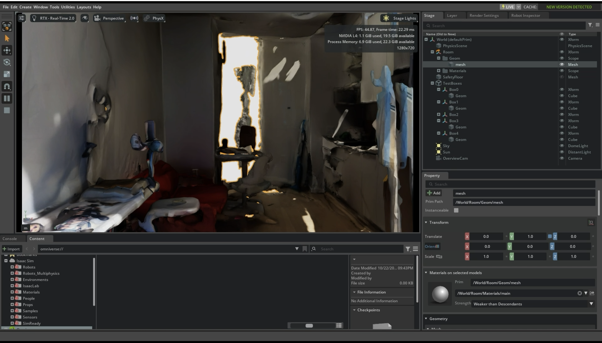
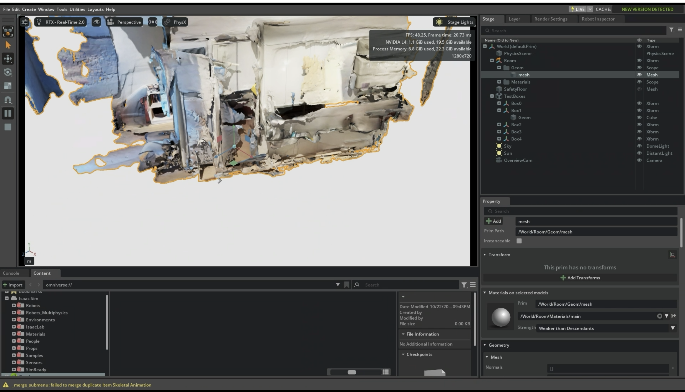
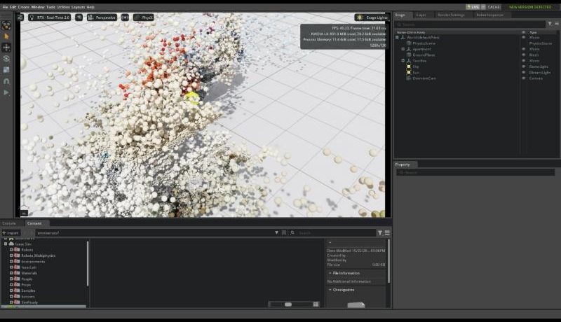

# Apartment Digital Twin in NVIDIA Isaac Sim

I scanned a room in my apartment with an iPhone and turned it into a physics-enabled digital twin running in **NVIDIA Isaac Sim 6.0.1** (built on Omniverse / OpenUSD), on a cloud GPU from **NVIDIA Brev**. I had no prior 3D or simulation experience. It took about 1.5 hours and around $2 of GPU time.



## Pipeline

```
iPhone LiDAR scan (Scaniverse)
        │  export USDZ (textured mesh)
        ▼
NVIDIA Brev cloud GPU (1× L4, AWS us-east, $1.22/hr)
  └─ Isaac Launchable: Isaac Sim 6.0.1 + VS Code + browser streaming
        │  isaac/build_room_twin.py
        ▼
USD scene: room mesh + collision + physics + test objects + lights + camera
        │  isaac/open_room.py
        ▼
Isaac Sim, streamed to the browser (~48 FPS)
```

## What the scene contains

| Part | Details |
|---|---|
| Room | Scaniverse LiDAR mesh: 314,921 triangles, 8192×8192 photo texture, 5.9 m × 7.9 m, 3.2 m ceiling |
| Physics | PhysX scene with gravity, and triangle-mesh collision on every room surface |
| Test objects | 5 rigid 15 cm boxes, 1 kg each, dropped from 1.8 m onto the floor and furniture |
| Extras | Invisible safety floor, dome and sun lights, overview camera |

`build_room_twin.py` reads the scan's up axis and units, rotates and scales the room to Y-up metres, puts the floor at y = 0 and centres the room. It then applies `UsdPhysics.CollisionAPI` to every mesh and writes `room_twin.usda`, which references the original scan instead of copying it.

From outside, the scan is one collision-enabled mesh, and the Stage panel shows the generated scene:



## Reproduce it

1. **Scan the room.** In Scaniverse, use a **mesh / LiDAR** capture of the whole room, not a splat. Export it as **USDZ**.
2. **Get a GPU.** Deploy NVIDIA's [Isaac Launchable](https://docs.isaacsim.omniverse.nvidia.com/latest/installation/install_advanced_cloud_setup_launchable.html) on Brev. A 1× L4 is enough. First-time setup takes about 25 minutes.
3. **Upload.** Open the instance's secure link (VS Code in the browser). Drag the `.usdz` and the `isaac/` scripts into `/workspace`.
4. **Build and launch:**
   ```bash
   /isaac-sim/python.sh isaac/build_room_twin.py "/workspace/<your scan>.usdz"
   ACCEPT_EULA=Y /isaac-sim/runheadless.sh --exec /workspace/room/open_room.py
   ```
5. **View.** Open `<instance link>/viewer/`. Only one viewer tab can be open at a time. Press ▶ to run the physics.
6. **Clean up.** Delete the Brev instance when you're done, because it bills hourly.

## First attempt: Gaussian splats

The first scan was a Gaussian-splat export: a PLY file with 219k splats that covered only one corner of the room. `scan_to_usd/splat_ply_to_usd.py` converts that format into USD. It turns each splat into a coloured `UsdGeom.Points` point and builds a 4 cm voxel collision mesh. This runs without the USD library, because it writes `.usda` text directly. Isaac Sim draws each point as a sphere, so the result looked like a cloud of beads:



**Lesson learned:** use a mesh capture for simulation work. Splats look great in a splat viewer, but simulators expect surfaces.

## Not included

The raw scans (`.usdz`, `.ply`) are excluded because they are a 3D model of the inside of my home, and they are also large.

## Next steps

- Add a robot from Isaac Sim's asset library (for example, a wheeled robot or a quadruped) and drive it around the room.
- Use proper physics materials for the floor and furniture (friction, restitution).
- Scan the rest of the apartment and merge the rooms into one scene.
